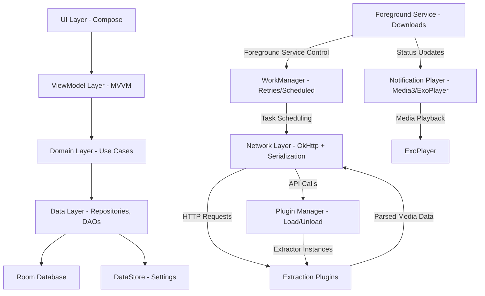
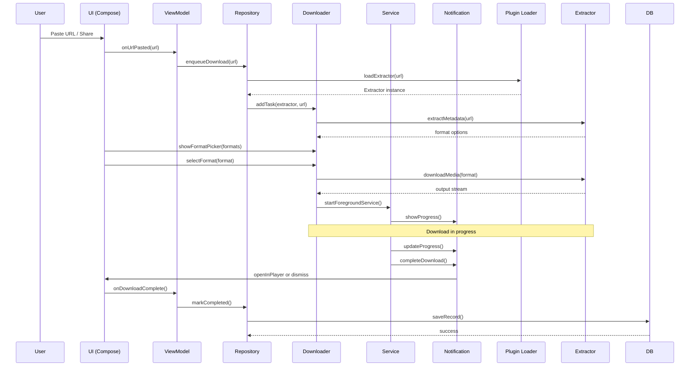
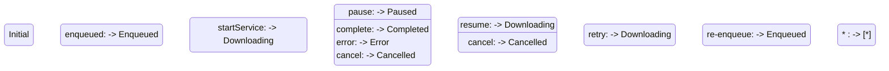

# OnagiTube Architecture

## Component Diagram

## Download Sequence Diagram

## State Machine (Download Status)

## Key Architecture Notes

- **MVVM + Clean Layers**: `ui` (Compose), `domain` (Use Cases), `data` (Repositories, DAOs, Room, DataStore), `core` (DI via Hilt, Coroutines/Flow)
- **Extraction Separation**: Plugins loaded at runtime; crashing plugin isolated host
- **Transport Layer**: OkHttp 4/5 + kotlinx.serialization (self-implemented, no Wandoujia SDK)
- **Background Work**: Foreground Service for active downloads, WorkManager for retries/scheduling
- **Media Playback**: Media3 (ExoPlayer) for in-app preview and completion handling
- **Image Loading**: Coil
- **Persistence**: Room (SQLite) for download history, DataStore for user settings

## Permitted Sources (B4)

Direct file URLs, user-owned or Creative Commons/public-domain content, podcasts/RSS enclosures, open HLS/DASH streams (non-DRM).